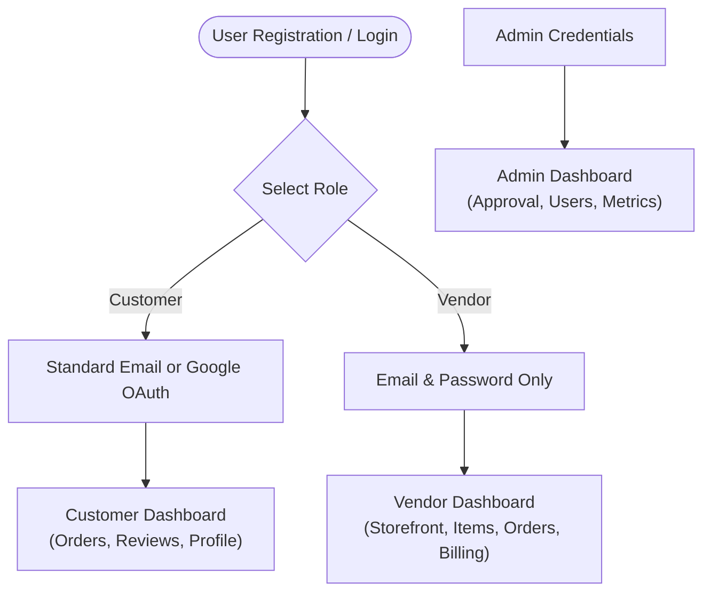

# PizzaHub — Frontend Client

[](https://nextjs.org/)
[](https://react.dev/)
[](https://tailwindcss.com/)
[](https://www.better-auth.com/)
[](https://www.typescriptlang.org/)

**PizzaHub** is a modern, responsive, full-stack artisanal pizza marketplace connecting local pizzerias with food lovers. Handcrafted with Next.js 16 (App Router & Turbopack), React 19, Tailwind CSS v4, Better Auth, and Framer Motion, PizzaHub delivers a tailored multi-role experience for Customers, Vendors, and Administrators.

---

## Project Links

- **Live Website:** [PizzaHub](https://pizzahub-by-asif.vercel.app)
- **Client Repository:** [PizzaHub Client](https://github.com/asif213067/PizzaHub-Client)
- **Server Repository:** [PizzaHub Server](https://github.com/asif213067/PizzaHub-Server)

---

## Table of Contents

- [Project Overview](#project-overview)
- [Key Features](#key-features)
  - [Customer Experience](#customer-experience)
  - [Vendor Experience & Dashboard](#vendor-experience--dashboard)
  - [Admin Experience & Governance](#admin-experience--governance)
  - [Authentication & Role Management](#authentication--role-management)
- [Technology Stack](#technology-stack)
- [Project Directory Structure](#project-directory-structure)
- [Installation & Setup](#installation--setup)
- [Environment Variables](#environment-variables)
- [Available Scripts](#available-scripts)
- [Application Routes](#application-routes)
- [Backend Integration & API Client](#backend-integration--api-client)
- [Authentication & User Roles](#authentication--user-roles)
- [Deployment](#deployment)
- [Troubleshooting](#troubleshooting)
- [Future Improvements](#future-improvements)
- [License & Repository](#license--repository)

---

## Project Overview

PizzaHub solves the disconnect between artisanal local pizzerias and hungry customers by offering an end-to-end multi-role web platform:

- **Customers** can explore curated gourmet pizzas, filter by dietary categories and geographic locations, place orders with custom delivery dates and special instructions, monitor order status transitions in real time, and submit verified customer reviews with 1–5 star ratings once orders are accepted.
- **Vendors (Pizzerias)** have access to a dedicated dashboard to manage their digital storefront, upload high-resolution images via ImgBB directly from their device, track incoming orders, accept or reject delivery requests, and manage Free vs. Premium subscriptions (enforcing a 3-item limit on the Free tier and unlocking unlimited items on Premium).
- **Platform Administrators** maintain platform quality through a centralized governance dashboard, approving or rejecting vendor menu items before they go public, monitoring platform analytics and subscription revenue, and blocking abusive accounts with instant token invalidation.

---

## Key Features

### Customer Experience
- **Interactive Landing Page:** Hero showcase, popular pizza categories, featured pizzas, value proposition cards, and "How It Works" walkthrough.
- **Browse Menu & Filtering:** Full menu listing with instant search, category filters (Classic, Vegetarian, Meat Lovers, Gourmet, Sides, Beverages), location filters, and price/date sorting.
- **Pizza Details & Multi-Image Carousel:** Dynamic detail pages featuring image thumbnail galleries, vendor store badges, price breakdowns, and related vendor pizzas.
- **Ordering System:** Modal-based checkout collecting delivery date, address, and special instructions. Vendors are strictly prevented from ordering their own items.
- **Order Management & Cancellation:** Track active and past orders categorized by status (`Pending`, `Accepted`, `Rejected`, `Cancelled`). Customers can cancel any pending order prior to vendor acceptance.
- **Verified Purchase Reviews:** Customers can submit 1–5 star ratings and detailed feedback on orders once marked as **Accepted** by the vendor. Duplicate reviews for the same order are strictly prevented.
- **Profile Management:** Update personal information (name, phone, address) and upload profile avatars directly from computer or mobile devices.

### Vendor Experience & Dashboard
- **Storefront & Profile Management:** Configure pizzeria business name, contact phone, and kitchen location.
- **Menu Item Management:**
  - Create new menu items with multi-image support (up to 2–3 images per item).
  - Images upload directly to ImgBB from the device with real-time preview and progress indicators.
  - Automatic form reset upon successful creation.
  - Consistent menu card sizing with line-clamping and responsive two-row mobile actions (`Available + View Details` / `Edit + Delete`).
  - Edit existing items and preview/replace photos.
  - Availability toggle (`Available` vs `Unavailable`) restricted strictly to **Accepted/Approved** items.
- **Tier-Based Limits (Free vs. Premium):**
  - **Free Tier:** Limited to 3 active menu items. Attempts to exceed the limit are blocked with an upgrade prompt.
  - **Premium Tier:** Unlimited menu items, verified vendor badge, and featured placement.
- **Order Fulfillment:** Incoming order stream with customer delivery notes, delivery dates, and one-click **Accept** or **Reject** actions.
- **Subscription Management:** View active plan, billing cycle, expiration date, and upgrade/cancel via Stripe checkout session integrations.

### Admin Experience & Governance
- **Platform Overview:** High-level metrics tracking total users, active vendors, published menu items, order counts, and transaction revenue.
- **Menu Item Moderation:** Review queue for all vendor submissions with ability to **Approve**, **Reject**, or **Deactivate** items across the marketplace.
- **User & Vendor Management:** Comprehensive user table displaying role badges, registration dates, and a toggle-block mechanism that immediately revokes API access for blocked accounts.
- **Transaction Logs:** Auditable log of all Stripe subscription transactions and payments.
- **Read-Only Admin Profile:** Secure, view-only administrative identity view preventing unauthorized permission or profile mutations.

### Authentication & Role Management
- **Better Auth Integration:** Powered by `@better-auth/mongo-adapter` with secure session management, salted password hashing, and cookie-based authentication.
- **Google OAuth Sign-In:** One-click Google Sign-In for customer accounts with automated OAuth state redirection.
- **Role Isolation Policy:** Vendors must register using the standard email-and-password form to ensure explicit business attribution.
- **Unique Email Constraint:** Case-normalized email validation ensuring an email cannot be registered under multiple accounts or roles.
- **Express JWT Synchronization:** Automatic synchronization between Better Auth sessions and Express backend JWT tokens via `/api/auth/jwt`.

---

## Technology Stack

| Category | Technology | Purpose |
| :--- | :--- | :--- |
| **Framework** | [Next.js 16.4.6](https://nextjs.org/) | React framework with App Router, Turbopack, and Server Components |
| **UI Library** | [React 19.3.0](https://react.dev/) | Component-based user interface rendering |
| **Styling** | [Tailwind CSS 4.3.3](https://tailwindcss.com/) | Utility-first styling with modern CSS color variables and theme tokens |
| **Authentication** | [Better Auth 1.7.26](https://www.better-auth.com/) | Authentication framework supporting email/password, Google OAuth, and session tokens |
| **Database Adapter**| `@better-auth/mongo-adapter` | Native MongoDB connection adapter for Better Auth |
| **Animations** | [Framer Motion 14.14.0](https://www.framer.com/motion/) | Smooth entrance animations, floating badge transitions, and layout transitions |
| **Icons** | [Lucide React 1.75.0](https://lucide.dev/) | Clean, consistent icons across all navigation, modals, and stat cards |
| **Notifications** | [Sonner 2.0.8](https://sonner.emilkowal.ski/) | Toast notification system with dark/light mode integration |
| **Payments** | [Stripe 23.2.0](https://stripe.com/) | Client SDK integration for Stripe Checkout sessions |
| **Language** | [TypeScript 5.x](https://www.typescriptlang.org/) | Static type safety and autocomplete |

---

## Project Directory Structure

```text
pizzahub-client-tmp/
├── public/                       # Static public assets (favicons, images, audit reports)
│   ├── audit-report.md           # Full E2E audit documentation
│   └── favicon.ico
├── src/
│   ├── app/                      # Next.js App Router route segments
│   │   ├── (main)/               # Main layout group (Navbar + Footer)
│   │   │   ├── menu/             # /menu (Browse menu listing & filters)
│   │   │   │   ├── [id]/         # /menu/[id] (Pizza details & reviews)
│   │   │   │   │   └── loading.tsx
│   │   │   │   └── loading.tsx
│   │   │   ├── payment-cancel/   # /payment-cancel (Stripe cancel redirect)
│   │   │   ├── payment-success/  # /payment-success (Stripe success redirect)
│   │   │   ├── layout.tsx
│   │   │   ├── not-found.tsx
│   │   │   └── page.tsx          # Homepage / Landing page
│   │   ├── api/                  # Route handlers (Better Auth & Webhooks)
│   │   │   ├── auth/[...all]/    # Better Auth Next.js API handler
│   │   │   └── webhooks/stripe/  # Stripe client-side webhook proxy
│   │   ├── auth/                 # Authentication pages
│   │   │   ├── callback/         # /auth/callback (Google OAuth redirect)
│   │   │   ├── signin/           # /auth/signin (Sign In Form)
│   │   │   └── signup/           # /auth/signup (Sign Up Form)
│   │   ├── dashboard/            # Dashboard layout & protected segments
│   │   │   ├── admin/            # Admin dashboard (/dashboard/admin, items, users, profile)
│   │   │   ├── customer/         # Customer dashboard (/dashboard/customer, orders, profile)
│   │   │   ├── vendor/           # Vendor dashboard (/dashboard/vendor, items, orders, add-item, subscription, profile)
│   │   │   ├── layout.tsx        # Dashboard layout with persistent sidebar
│   │   │   └── loading.tsx       # Route loading skeleton for all dashboard tabs
│   │   ├── globals.css           # Global Tailwind v4 directives and CSS theme variables
│   │   ├── layout.tsx            # Root HTML layout, Inter & Poppins fonts, Toaster
│   │   ├── loading.tsx           # Global fallback route loading screen
│   │   └── not-found.tsx         # Branded custom 404 Not Found page
│   ├── components/               # Modular UI components
│   │   ├── auth/                 # Auth forms (signin, signup, vendor guidance)
│   │   ├── dashboard/            # Shared dashboard components (sidebar, header, charts, stat cards)
│   │   │   ├── admin/            # Admin stat cards, user tables, approval lists
│   │   │   ├── orders/           # Order cards, cancel modal, review modal, pagination
│   │   │   └── vendor/           # Vendor item cards, edit modals, tier banners, charts
│   │   ├── landing-page/         # Hero banner, categories, featured items, testimonials
│   │   ├── menu/                 # Menu filters, menu grid, item details, review carousel
│   │   ├── shared/               # Navbar, footer, pizza card, theme toggle
│   │   └── ui/                   # Shared UI primitives (Button)
│   ├── lib/                      # Core utility libraries & clients
│   │   ├── api-client.ts         # Axios/Fetch API client with token sync & error handlers
│   │   ├── auth-client.ts        # Better Auth React client instance
│   │   ├── auth.ts               # Better Auth server configuration with MongoDB adapter
│   │   ├── upload-imgbb.ts       # Direct browser-to-ImgBB image upload helper
│   │   └── utils.ts              # ClassName merge (`cn`) utility
│   └── types/                    # Shared TypeScript interfaces & types
│       ├── admin.ts
│       ├── order.ts
│       └── vendor.ts
├── package.json                  # Dependencies, scripts, and package metadata
├── tsconfig.json                 # TypeScript compiler configuration
└── next.config.ts                # Next.js configuration (remote image hostnames)
```

---

## Installation & Setup

### Prerequisites
- **Node.js:** v18.18.0 or later (v20+ or v22+ recommended)
- **Package Manager:** `npm`, `yarn`, `pnpm`, or `bun`
- **MongoDB Database:** Local MongoDB instance or free MongoDB Atlas cluster
- **PizzaHub Backend:** The Express backend service (`pizzahub-server`) running concurrently (defaults to `http://localhost:5000`)
- **ImgBB API Key (Optional but recommended):** Free key from [api.imgbb.com](https://api.imgbb.com/) for profile and menu photo uploads.

### 1. Clone the Repository
```bash
git clone https://github.com/your-username/PizzaHub.git
cd PizzaHub/pizzahub-client-tmp
```

### 2. Install Dependencies
```bash
npm install
```

### 3. Configure Environment Variables
Create a `.env.local` file in the root of `pizzahub-client-tmp`:
```bash
cp .env.example .env.local
```
Fill in your local configuration parameters (see [Environment Variables](#environment-variables)).

### 4. Run the Development Server
```bash
npm run dev
```

The application will be accessible at:
👉 **[http://localhost:3000](http://localhost:3000)**

---

## Environment Variables

The frontend utilizes the following environment variables. Store them in `.env.local`:

```ini
# ==============================================================================
# PizzaHub Frontend Client Configuration
# ==============================================================================

# 1. Site & API Base URLs
NEXT_PUBLIC_SITE_URL=http://localhost:3000
NEXT_PUBLIC_SERVER_BASE_URL=http://localhost:5000

# 2. Better Auth Configuration
BETTER_AUTH_URL=http://localhost:3000
BETTER_AUTH_SECRET=your_better_auth_secret_minimum_32_characters_long

# 3. MongoDB Connection (Required for Better Auth Database Adapter)
MONGODB_URI=mongodb+srv://<username>:<password>@cluster0.mongodb.net/?retryWrites=true&w=majority
DB_NAME=pizzahub

# 4. Google OAuth Credentials (Optional: for Google Sign-In)
GOOGLE_CLIENT_ID=your-google-client-id.apps.googleusercontent.com
GOOGLE_CLIENT_SECRET=your-google-client-secret

# 5. ImgBB Image Upload API Key (Used for device photo uploads)
NEXT_PUBLIC_IMGBB_API_KEY=your_imgbb_api_key_here
```

> [!IMPORTANT]
> - Never commit your `.env.local` file to version control.
> - Ensure `MONGODB_URI` points to the same database used by the Express backend for seamless user and credential synchronization.

---

## Available Scripts

Defined in `package.json`:

| Script | Command | Purpose |
| :--- | :--- | :--- |
| `dev` | `next dev` | Starts the local development server with Turbopack on `http://localhost:3000`. |
| `build` | `next build` | Compiles the production build, optimizes bundles, and pre-renders static routes. |
| `start` | `next start` | Runs the compiled Next.js production server (requires running `build` first). |
| `lint` | `eslint` | Runs ESLint to check for syntax issues, unused variables, and styling discrepancies. |

---

## Application Routes

### Public Pages
- `/` — Homepage featuring the hero banner, category explorer, and top featured pizzas.
- `/menu` — Searchable and filterable full menu with category pills, location selector, and pagination.
- `/menu/[id]` — Pizza details page with multi-image gallery, vendor storefront information, verified customer reviews carousel, and the order dialog.
- `/payment-success` — Polished confirmation card displayed following successful Stripe subscription checkout.
- `/payment-cancel` — Support and retry screen displayed when a Stripe checkout session is cancelled.
- `/*` — Custom 404 Not Found page with return-home and browse-menu action shortcuts.

### Authentication Pages
- `/auth/signin` — Sign In page with email/password authentication, Google Sign-In, and vendor registration instructions.
- `/auth/signup` — Sign Up page featuring customer vs. vendor role toggle, device profile photo upload, and email validation.
- `/auth/callback` — OAuth redirection handler processing Google sign-in sessions.

### Customer Dashboard (`/dashboard/customer/*`)
- `/dashboard/customer` — Customer overview with order stats, 6-month historical activity charts, and recent order stream.
- `/dashboard/customer/orders` — Order history tracking with status filters, cancellation dialogs, and verified review submissions.
- `/dashboard/customer/profile` — Profile settings to edit name, phone, address, and profile photo.

### Vendor Dashboard (`/dashboard/vendor/*`)
- `/dashboard/vendor` — Vendor overview with active item counters, Free/Premium tier banner, status distribution doughnut chart, and revenue metrics.
- `/dashboard/vendor/items` — My Menu Items view with consistent card layouts, two-row mobile actions, available status toggles, and edit/delete modals.
- `/dashboard/vendor/add-item` — Add Item form supporting multi-image upload, automated state reset, and Free-tier 3-item limit protection.
- `/dashboard/vendor/orders` — Vendor incoming order management with accept and reject status controls.
- `/dashboard/vendor/subscription` — Subscription management with Free vs. Premium comparison, Stripe checkout integration, and cancellation controls.
- `/dashboard/vendor/profile` — Restaurant business information and brand logo upload.

### Admin Dashboard (`/dashboard/admin/*`)
- `/dashboard/admin` — Platform-wide statistics on registered users, vendors, menu items, and transaction volume.
- `/dashboard/admin/items` — Menu approval dashboard to approve, reject, or deactivate vendor items.
- `/dashboard/admin/users` — User management table with role badges and account blocking/unblocking controls.
- `/dashboard/admin/profile` — View-only administrative identity credentials.

---

## Backend Integration & API Client

All asynchronous data communication between the frontend and the Express backend is orchestrated through `src/lib/api-client.ts`:

1. **Base URL Resolution:**
   Reads `NEXT_PUBLIC_SERVER_BASE_URL` (defaulting to `http://localhost:5000`).
2. **JWT Synchronization (`syncAuthToken`):**
   When a user logs in via Better Auth, their email is verified and sent to `POST /api/auth/jwt` on the Express backend. The returned signed JWT is stored in `localStorage` under `pizzahub_jwt`.
3. **Automatic Authorization Headers:**
   Every outgoing request issued via `api.get`, `api.post`, `api.patch`, `api.put`, or `api.delete` automatically attaches `Authorization: Bearer <token>`.
4. **401/403 Handling:**
   If a request encounters a `401 Unauthorized` or `403 Forbidden` due to account blocking or token expiration, the stored token is safely cleared to prevent stale state.

---

## Authentication & User Roles

PizzaHub enforces strict Role-Based Access Control (RBAC):



- **Customer:** Default user role. Can browse, order, cancel pending orders, review accepted orders, and manage personal profile settings.
- **Vendor:** Restaurant partner role. Accesses vendor menus, handles order acceptance/rejection, manages subscriptions, and updates pizzeria details. *Note: Vendors must register via email/password.*
- **Admin:** Platform governance role. Approves menu items, oversees users, monitors transactions, and views governance credentials. The admin profile is read-only.

---

## Deployment

The PizzaHub client is optimized for zero-configuration deployment on **[Vercel](https://vercel.com/)**:

### 1. Deploying to Vercel
1. Push your code to GitHub, GitLab, or Bitbucket.
2. Import the project repository into the Vercel Dashboard.
3. Set the **Root Directory** to `pizzahub-client-tmp` if deploying from a monorepo or subdirectory.
4. Add all production environment variables (from the [Environment Variables](#environment-variables) section) into the Vercel Project Settings.
5. Click **Deploy**.

### 2. Production Environment Checklist
- Ensure `NEXT_PUBLIC_SITE_URL` and `BETTER_AUTH_URL` match your production domain (e.g., `https://pizzahub.yourdomain.com`).
- Ensure `NEXT_PUBLIC_SERVER_BASE_URL` points to your deployed Express backend URL (e.g., `https://api.pizzahub.yourdomain.com`).
- In MongoDB Atlas, verify that your production IP whitelist allows connections from your deployment platform.

---

## Troubleshooting

### 1. `Missing or null Origin` error on registration
- **Cause:** Better Auth includes CSRF protection requiring matching origin and referrer headers.
- **Solution:** Verify that `BETTER_AUTH_URL` and `NEXT_PUBLIC_SITE_URL` in `.env.local` match the exact protocol and port you are browsing on (`http://localhost:3000`).

### 2. Profile or menu item image upload fails
- **Cause:** Missing or expired ImgBB API key, or file size exceeds limits.
- **Solution:** Confirm that `NEXT_PUBLIC_IMGBB_API_KEY` is present in `.env.local`. Ensure uploaded image files are in JPG, PNG, WEBP, or GIF format and under 5 MB.

### 3. Orders or Dashboard queries return 401 Unauthorized
- **Cause:** JWT token has not been synchronized between Better Auth and the Express backend.
- **Solution:** Ensure the Express backend (`pizzahub-server`) is running on port 5000. Logging out and logging back in will trigger a fresh token synchronization.

### 4. Duplicate Navbar or Footer on 404 pages
- **Solution:** Custom error views and not-found segments rely on the layout tree. The root `not-found.tsx` renders its own content without embedding nested header/footer components.

---

## Future Improvements

Features planned for upcoming releases:
- Real-time WebSocket or Server-Sent Events (SSE) for live order status notifications.
- Integrated map view and delivery radius calculation for local pizzerias.
- Direct customer chat with vendor kitchens for custom order modifications.
- Multi-currency support for international pizza vendors.

---

## License & Repository

This project was developed for educational and portfolio demonstration purposes.

- **Repository:** https://github.com/asif213067/PizzaHub-Client
- **Backend Service:** [PizzaHub Express Server](https://github.com/asif213067/PizzaHub-Server)

---

## Author

**Asif Hosen**\
Full-Stack Developer

-   Website: https://togetherwe-client-by-asif.vercel.app
-   GitHub: https://github.com/asif213067
-   Linkedin: https://www.linkedin.com/in/asif-hosen

------------------------------------------------------------------------

Built with the goal of making local community service easier to
discover, organize, and join.
